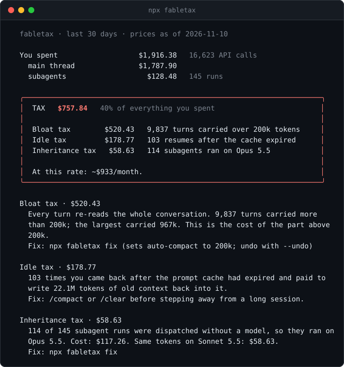

# fabletax

In the last 30 days, $758 of my $1,916 Claude Code spend (40%) was avoidable. fabletax reads your local transcripts and shows where yours went.



```sh
npx fabletax
```

No install, no API key, no dependencies. It reads `~/.claude/projects`, prices the token counts at list price, and prints three kinds of avoidable spend. Nothing leaves your machine. Node 18 or newer, macOS and Linux.

## The three taxes

**Bloat tax.** Every turn re-reads the whole conversation. Models with a 1M context window auto-compact at about 967k tokens by default, so a long session can re-read close to 1M tokens on every turn. The bloat tax is the cost of the part above 200k, on every main-thread turn that went over.
For me: $520, from 9,837 turns over 200k tokens. The largest carried 967k.

**Idle tax.** The prompt cache expires. If you leave a long session and come back, the whole context is written to the cache again at the write price instead of read at the read price. The idle tax is that difference.
For me: $179, from 103 cold resumes that re-cached 22.1M tokens.

**Inheritance tax.** A subagent dispatched with no `model:` runs on the model that dispatched it. If that is Opus or Fable, a research or grep task runs at Opus or Fable prices. The inheritance tax is what those runs cost minus the same tokens at Sonnet 5.5 prices. Forks, runs with an explicit `model:` and runs whose dispatch cannot be found are never counted.
For me: $59, from 114 of 145 subagent runs that ran on Opus 5.5.

I built this expecting the inheritance tax to be the big one. It was 3% of my spend. Context bloat was 27%.

Real output from my machine, with `--share` (project names left out):

```text
  fabletax · last 30 days · prices as of 2026-11-10

  You spent                   $1,916.38   16,623 API calls
    main thread               $1,787.90
    subagents                   $128.48   145 runs

  ╭──────────────────────────────────────────────────────────────────────╮
  │  TAX   $757.84   40% of everything you spent                         │
  │                                                                      │
  │  Bloat tax        $520.43   9,837 turns carried over 200k tokens     │
  │  Idle tax         $178.77   103 resumes after the cache expired      │
  │  Inheritance tax   $58.63   114 subagents ran on Opus 5.5            │
  │                                                                      │
  │  At this rate: ~$933/month.                                          │
  ╰──────────────────────────────────────────────────────────────────────╯
```

The full report also lists the worst sessions, spend by model and a config check.

## Fix it

```sh
npx fabletax fix
```

`fix` prints a plan and asks before it changes anything. It can:

1. Set `autoCompactWindow: 200000` in `~/.claude/settings.json`.
2. Install a PreToolUse guard hook. When an `Agent` call passes no `model:` and the dispatching model is Opus or Fable, the hook adds `model: sonnet`. An explicit `model:` always wins. Forks, plugin agents and other built-in agent types are left alone.
3. Add `model: sonnet` to custom agents in `~/.claude/agents` and `.claude/agents` that have none.

Every file is backed up first. `npx fabletax fix --undo` restores them.

Options: `--yes`, `--undo`, `--model sonnet|haiku`, `--cap <tokens>`, `--no-hook`, `--no-agents`, `--no-compact`.

`FABLETAX_GUARD=off` turns the hook off. `FABLETAX_MODEL=haiku` changes its target. It also stays silent when `CLAUDE_CODE_SUBAGENT_MODEL_FORCE` is set.

## As a Claude Code plugin

```text
/plugin marketplace add patrickballard/fabletax
/plugin install fabletax@fabletax
```

This gives you the guard hook and an `/fabletax:audit` skill that runs the audit inside Claude Code. It does not change your settings. For the auto-compact setting, run `npx fabletax fix` or `/autocompact 200k`.

## How the numbers are computed

Every figure is real token counts from your transcripts multiplied by a dated price table in one file, [`src/prices.mjs`](src/prices.mjs). On 67 of 67 session cost records I checked (Opus 5.5 and Opus 5), Claude Code's own recorded cost fell inside the range the table predicts. Those records do not split cache writes by lifetime, so the check is a range, not an exact match. The exact definitions, formulas and known inaccuracies are in [docs/HOW-IT-WORKS.md](docs/HOW-IT-WORKS.md).

I also tested the guard on Claude Code 2.1.306. The same one-line "ping" subagent task ran on claude-opus-5-5 without the guard (2 runs, $0.132 each) and on claude-sonnet-5-5 with it (1 run, $0.090).

Prices used, USD per million tokens, from the Anthropic pricing page on 2026-11-10: Fable 5.2 $8 in / $40 out, Opus 5.5 $4 / $20, Sonnet 5.5 $2 / $10, Haiku 5.5 $0.10 / $0.50. Cache reads are $0.20 on Fable 5.2 and Opus 5.5. 1-hour cache writes cost 2x input. `fabletax prices` prints the whole table.

## Privacy

fabletax reads local files and prints a report. The code contains no network calls and no dependencies. It never prints prompt or response text. `--share` also leaves out project names and task descriptions, so you can screenshot the output. `fix` writes only to your Claude config folder, and only after you say yes.

## Why not ...?

| Tool | Good at | How fabletax differs |
| --- | --- | --- |
| [ccusage](https://github.com/ccusage/ccusage) (19.4k stars) | Totals by day, session and model from the same local logs. The standard. | It does not say what was avoidable or change anything. Use both. |
| ccstatusline (13.6k) | Live statusline widgets for current usage. | It shows now. fabletax looks back over 30 days. |
| claude-code-router (38k) | Routes Claude Code to other providers and models through a proxy. | Different goal: it moves you off Anthropic models. fabletax keeps you on Claude, needs no proxy and changes two settings. |
| ax (123, AGPL) | Observability and memory for agent sessions. Installed with a curl script. | Much broader and heavier. fabletax is one report and one fix. |
| claude-model-router and similar | Prompt-level routing of subtasks. | The guard is a hook of about 140 lines that only fills in a missing `model:`. |
| `/usage`, `/context` | The current session. | No history, no repricing. |
| `/autocompact 200k`, per-agent `model:`, `CLAUDE_CODE_SUBAGENT_MODEL` | The manual versions of what `fix` does. | `fix` does them together, with a backup and an undo. Since v2.1.251 the env var no longer overrides pinned agents. |

Star counts are as of 2026-11-10.

## Limits

- It is an estimate, not a bill. It reprices token counts at list price.
- On a subscription the figures are list-price value, not charges. fabletax cannot tell plan allowance from usage credits.
- The transcript format is undocumented and can change between Claude Code versions.
- Claude Code deletes transcripts after 30 days by default, so history is limited.
- Compacting at 200k trades cost for memory. Some work needs the long context.
- A cheaper subagent model may use more or fewer tokens, and some subagent work needs the big model.
- macOS and Linux only for now.

## Flags

| Flag | Meaning |
| --- | --- |
| `--days <n>` | Look back n days (default 30) |
| `--all` | Look at everything |
| `--project <text>` | Only projects whose name contains text |
| `--as sonnet\|haiku` | Model to reprice subagent runs on (default sonnet) |
| `--cap <tokens>` | Context size the bloat tax is measured above (default 200k) |
| `--json` | Print `{ report, config }` as JSON and nothing else |
| `--share` | Leave out project names and descriptions |
| `--verbose` | Also show descriptions, projects and finding details |
| `--no-color` | Plain output |
| `--claude-dir <path>` | Claude config folder (default `$CLAUDE_CONFIG_DIR` or `~/.claude`) |
| `fabletax prices` | Print the price table |

## Contributing

Read [CONTRIBUTING.md](CONTRIBUTING.md). Zero dependencies is a hard rule. Run the tests with `npm test`. A price change must link the pricing page it was checked against.

## Licence

MIT. See [LICENSE](LICENSE).
